# Zijia Li

**MSE in Data Science at Penn · GMLR, GRASP Lab**

<picture>
  <source media="(prefers-color-scheme: dark)" srcset="https://raw.githubusercontent.com/peter-lizijia/peter-lizijia/main/assets/typing-dark.svg">
  
</picture>

[](https://peter-lizijia.github.io/)
[](https://scholar.google.com/citations?user=Tj5MVykAAAAJ)
[](https://www.linkedin.com/in/zijia-li-323804383/)
[](mailto:lizijia@engineering.upenn.edu)
[](https://x.com/Peter_LiZijia)

## About me

I'm a master's student at the University of Pennsylvania, working with Prof. Jiatao Gu on world models and visual representation learning. My background is in Mathematics with Applied Mathematics at the University of Nottingham and UNNC.

I am interested in how models learn visual structure and dynamics that generalize to prediction, planning, and control.

> Seeking PhD opportunities starting in **Fall 2027**. Happy to connect over shared research interests.

## Research & tools

- **Research:** world models, visual representation learning, video models, and image generation.
- **Methods:** normalizing flows, flow matching, diffusion models, and model-based reinforcement learning.
- **Tools:** `Python` · `JAX` · `R` · `MATLAB` · `SQL` · `LaTeX`

## Selected projects

- **[Gen-JEPA](https://github.com/peter-lizijia/Gen-JEPA)** — Explorations of generative predictors for JEPA-style world models; an earlier step toward NFWM.
- **[Slurm GPU Dashboard](https://github.com/peter-lizijia/slurm-gpu-dashboard)** — GPU monitoring and reservation coordination for research groups. [Live demo](https://peter-lizijia.github.io/slurm-gpu-dashboard/).
- **[Academic homepage](https://peter-lizijia.github.io/)** — Research, publications, and my latest CV.

## Publications

**Normalizing Flows are Capable World Models**  
Zijia Li*, Yong-Hyun Park*, Shusheng Yang, Jiatao Gu. *Equal contribution.*  
Workshop version accepted at **CoRL 2026 LEAP Workshop**. Full manuscript under review.

[Publication details](https://peter-lizijia.github.io/publications.html) · [Google Scholar](https://scholar.google.com/citations?user=Tj5MVykAAAAJ)

<!-- Add public paper, project, and code links here when they become available. -->

## On GitHub

<picture>
  <source media="(prefers-color-scheme: dark)" srcset="https://raw.githubusercontent.com/peter-lizijia/peter-lizijia/main/assets/stats-dark.svg?v=1">
  
</picture>
<picture>
  <source media="(prefers-color-scheme: dark)" srcset="https://raw.githubusercontent.com/peter-lizijia/peter-lizijia/main/assets/languages-dark.svg?v=1">
  
</picture>

<sub>Public GitHub activity only. Language percentages reflect repository source bytes, not proficiency.</sub>

### One contribution at a time

<picture>
  <source media="(prefers-color-scheme: dark)" srcset="https://raw.githubusercontent.com/peter-lizijia/peter-lizijia/main/assets/snake-dark.svg?v=1">
  
</picture>

<details>
<summary>A tiny research loop</summary>

```python
while curious:
    hypothesis = ask_a_better_question()
    evidence = run_the_experiment(hypothesis)
    update_beliefs(evidence)
```

</details>
